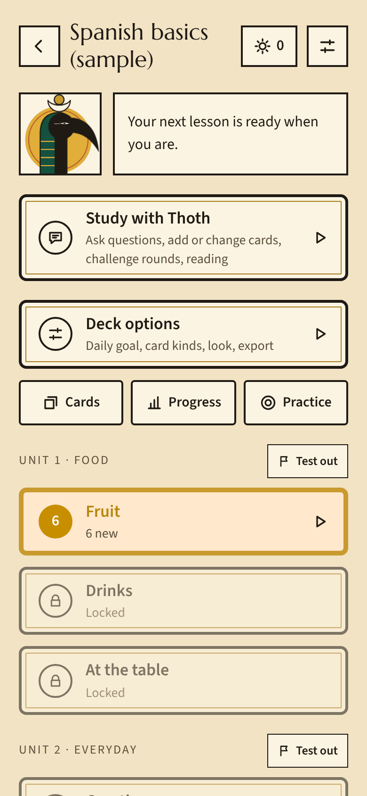
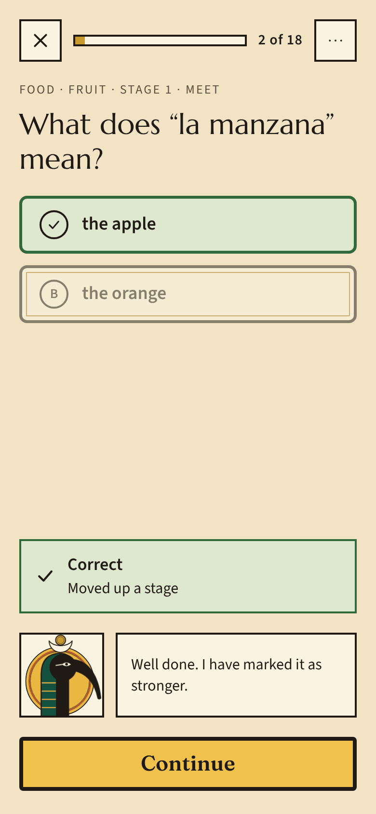
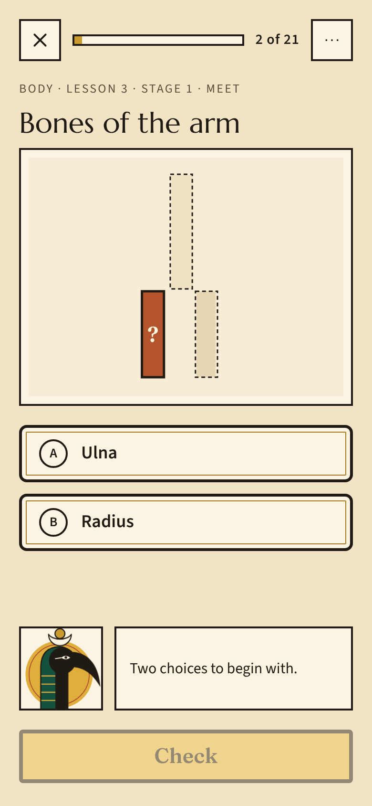
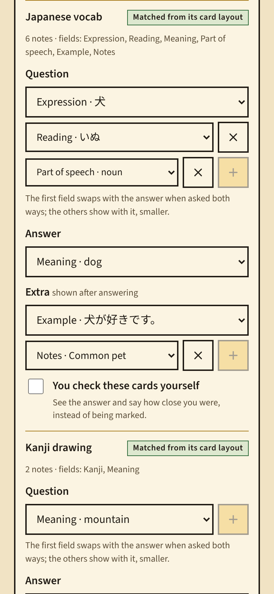
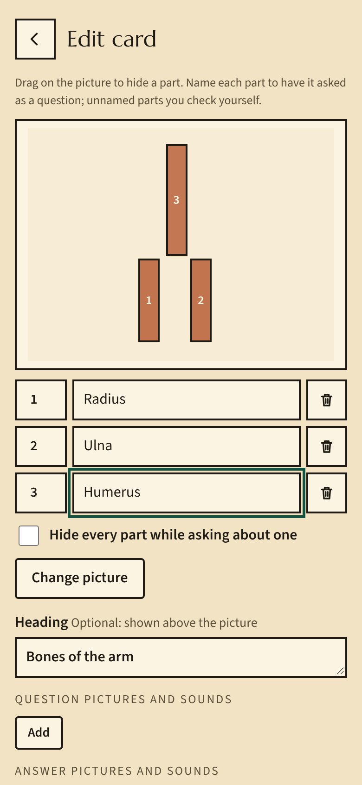
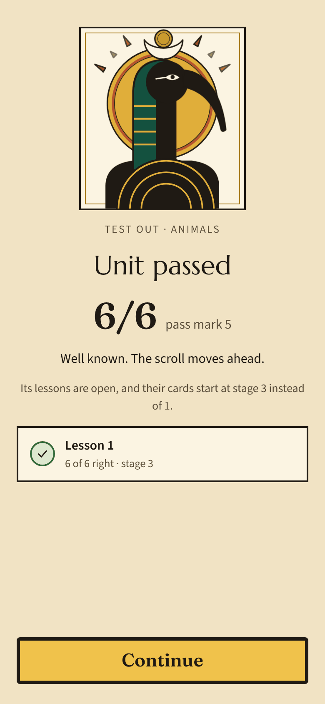

# Ankhwiz

**Spaced repetition that teaches as well as tests.** Ankhwiz takes the
memory science behind [Anki](https://apps.ankiweb.net) and wraps it in
short guided lessons: the app grades every answer itself, help fades as a
card grows stronger, and Thoth, a scribe of ancient Egypt, keeps you company
along the way. It reads and writes Anki decks, so nothing you have in Anki
is left behind, and nothing you make here is locked in.

Windows, Linux and Android, plus a one-file version for any browser. No
account, no server, no tracking: your decks stay on your device.

[**Download the latest release**](https://github.com/DR-KD1997/Ankhwiz/releases/latest) ·
[What's new](CHANGELOG.md) · [How it works](#how-learning-works) ·
[Working with Anki](#working-with-anki)

<table>
  <tr>
    <td></td>
    <td></td>
    <td></td>
  </tr>
  <tr>
    <td></td>
    <td></td>
    <td></td>
  </tr>
</table>

## Why Ankhwiz

Anki is the most effective way to remember almost anything, and for many
people it is also hard to keep up with. Its cards ask you to judge your own
recall, a wall of due cards greets you each morning, and a new deck offers
no sense of where to start. Ankhwiz keeps the scheduling science and changes
the experience around it:

- **The app marks your answers.** No more deciding between Again, Hard, Good
  and Easy: you pick or type the answer, and Ankhwiz grades it and turns the
  result into the scheduler's grade.
- **Help that fades.** A new card starts as a choice of two, grows to eight
  options, then becomes typed recall with live colour hints, and finally
  plain typed recall.
- **Lessons, not piles.** Decks are split into units and short lessons that
  open in order, with a gentle daily goal and reviews woven in.
- **A guide.** Thoth comments on your progress, reacts to your answers and
  suggests what to do next. Prefer quiet? Make him quiet, or hide him.
- **Anki compatible.** Import any `.apkg`, export back to Anki with your
  progress, and keep studying in either.

## How learning works

| Stage | You see | Moves up after |
| --- | --- | --- |
| 1 · Meet | The card, then a choice of 2 or 3 | one correct answer |
| 2 · Recognise | Multiple choice, 4 to 8 options, harder ones later | correct answers on 2 separate days |
| 3 · Assisted recall | Typing, with green, yellow and red as you type | 2 separate days, without going red |
| 4 · Firm recall | Typing, plain | 2 separate days |
| 5 · Mastered | Typing, with long gaps between reviews | stays while you are right |

A wrong answer drops a card one stage, never back to the start, and brings it
back a few cards later. Wrong options come from the same lesson first, then
the unit, then the deck, and grow more similar to the answer as the card
advances. When reviews are due they join your next lesson (up to three), or
you can review on their own. Scheduling uses the FSRS formulas Anki uses,
with a retention slider per deck.

## Features

### Studying
- **Lessons and units** that open in order; lesson size 3 to 12 cards.
- **Reviews** woven into lessons, or as a session of their own.
- **Study all decks:** every deck's due reviews in one mixed session.
- **Test out of a unit** you already know: up to 12 questions without hints;
  pass 10 and the unit opens with its cards at stage 3.
- **Practice** rounds (tricky cards, one unit, or the weakest cards) that
  never change the schedule.
- **Pick up where you left off** after closing the app mid-lesson.
- **Skip for today** and **Stop asking this one** (Anki's bury and suspend).
- **Daily goal** you can pass, a **streak** with milestones, and a
  **progress** page: cards by stage, the week ahead, share remembered.
- **Answer sounds** in four sets made on the spot, with no audio files: Reed
  marimba (the default), Lyre, Temple bell and Soft pop, or none.
- **Read aloud** with the device's own voices: a speaker button by the
  question and the answer, a language for each, and, if you like, reading by
  itself as each card opens or once it is checked.
- **Keyboard shortcuts** on desktop: number keys, Enter, E to explain, R to
  read aloud, S to skip, Esc to leave, ? for the list.

### Cards
- **Kinds:** one way, both ways (set for each kind of card), fill the gap
  (`{{c1::…}}`), pictures with hidden parts, and self-check.
- **Several fields:** Question and Extra can each hold several fields, added
  with **+** and put in order by holding and dragging. Each is a little
  smaller than the last, and past the third the rest fold away behind an
  arrow on the card. The first Question field is the one swapped with the
  answer when a card is asked both ways.
- **Pictures with hidden parts** (Anki's Image Occlusion): imported from
  Anki or drawn in the editor. Named parts are asked as questions; unnamed
  parts you check yourself.
- **Self-check** for cards the app cannot mark: see the answer, then say
  Missed it, Partly or Got it.
- **Also accepted** answers, hand-picked **wrong options**, **labels**,
  pictures and sounds on either side, text size, font and right-to-left per
  deck.
- **Card browser and editor** with search, filters and each card's history;
  rename and reorder lessons and units; up to five backups per deck.

### Thoth and AI
Thoth's built-in lines and animations work offline: he breathes, blinks and
glances about, nods at each new card, brightens at a right answer, droops in
sympathy at a wrong one, hops at a stage-up and lights up at a streak
milestone. Settings has **Moves** or **Still**, and he keeps still whenever
your system asks for reduced motion.

Connect an AI service of your own (OpenAI, Google Gemini, Grok, OpenRouter,
Ollama, LM Studio, or any service using the OpenAI chat format) and
**Study with Thoth** adds:

| | |
| --- | --- |
| Ask | Questions about the deck's subject, answered from its cards first |
| Add cards | Drafts from a topic or from text you paste |
| Improve | More accepted answers, harder wrong options, flags on doubtful cards, lesson names, and changes described in your own words, with a preview and an optional backup |
| Challenge | Fresh questions on what you have met, without touching the schedule |
| Reading | Passages with questions, written by AI or by you |
| In lessons | "Explain this" after any answer, and marking of long written answers |

Everything AI writes arrives as a draft for you to approve and is tagged
"AI". Before the first request, Ankhwiz shows what is sent and where. The key
stays in your device's key storage (Windows Credential Manager, the Linux
keyring, the Android Keystore) and never goes into decks or backups.

### Working with Anki
- **Import** `.apkg` files in both Anki package formats. Each note type is
  matched for you from its card layout (or recognised as an Ankhwiz, cloze or
  Image Occlusion type); change any field, add more with +, drag them into
  order, and choose Ask both ways for each note type; you can change the
  fields later in Deck options. Group cards
  into units by subdeck, by tag, or as one unit, and bring your Anki
  progress if you like.
- **Export** to `.apkg`: units become subdecks, lessons travel as `ankh::`
  tags, and progress can come along. Anki keeps each card's FSRS memory and
  its exact Ankhwiz stage.
- **Round trip:** tested with Anki 26.09's own library. Notes that came from
  Anki go back under their own note type, and unchanged notes go back
  exactly as they came.
- **`.ankh`**, Ankhwiz's own format, keeps everything exactly: lessons, card
  kinds, options, readings and progress.

### Your library
- **Back up everything** in one `.ankhlib` file (decks, pictures and sounds,
  progress and settings, never your AI key) and restore it on another device.
- **Daily reminder** at a time and on days you choose, only when you haven't
  studied yet. On Android it comes even when the app is closed.
- **Update check** when you ask, or, if you choose, when Ankhwiz opens (once
  a day at most), showing what's new: one request to GitHub for the latest
  release.
- Stored data is versioned and upgraded step by step.

### Accessible
Every control can be reached by keyboard with a clear focus ring; results are
announced to screen readers; pictures describe their hidden parts; light and
dark themes; one column on phones, path and lesson side by side on wide
screens. Interface text is moving into translatable files (`src/lib/i18n/`).

## Download

From the [Releases page](https://github.com/DR-KD1997/Ankhwiz/releases):

| Platform | File |
| --- | --- |
| Windows 10 and 11 | `…-windows-setup.exe` (installs for you only, no administrator rights), or `…-windows-x64.zip` to run without installing |
| Linux | `…_amd64.deb` for Debian, Ubuntu and Mint, or `…_amd64.AppImage` for any distribution |
| Android 7.0 and newer | `…-release.apk` (allow installing from unknown sources) |
| Any browser | `….html`, the whole app in one file |

Windows needs Microsoft Edge WebView2, part of Windows 11 and up-to-date
Windows 10. Until the Windows programs are signed (see Code signing below),
Windows may warn about an unknown publisher ("More info", then "Run anyway").
Linux reads aloud through speech-dispatcher, which most desktops include.

**Android, from 0.4.1.1:** the app is now signed with Ankhwiz's permanent
release key. Because earlier versions used a test key, 0.4.1.1 cannot install
over them: back up your library (Settings › Your library › Back up all),
uninstall the old app, install 0.4.1.1 and restore. Later versions install
over it as usual.

## Getting started

1. Add the sample Spanish deck, import an Anki `.apkg` or an `.ankh`, or
   paste a list (`la casa = the house`, one per line).
2. Do the first lesson.
3. Come back tomorrow for its review, or use **+1 day** under Settings ›
   Testing to try it now.
4. Optionally, set up an **AI connection** in Settings and open **Study with
   Thoth** on a deck.

On a deck's screen, under the lesson path's top:

| Button | What it holds | Anki's name |
| --- | --- | --- |
| Study with Thoth | Ask, Add cards, Improve, Challenge, Reading | – |
| Deck options | Daily goal, remembering slider, card kinds, lessons, look, export, backups, advanced | Deck options, presets |
| Cards | Every card by unit and lesson, the card editor | Browser |
| Progress | Stages, the week ahead, share remembered, streak, tricky cards | Statistics, leeches |
| Practice | Tricky cards, one unit, or cram | Custom study, filtered decks |
| Test out (on each unit) | A short quiz to skip ahead | – |

## How it is built

```
core/          Rust. Every learning rule: stages, grading, sessions, lesson
               splitting, scheduling, test outs, Anki import and export,
               AI prompts and reply checking. One JSON entry point, 63 tests.
src/           The shared interface (Svelte 5, TypeScript). Calls the core,
               compiled to WebAssembly, through src/lib/core/index.ts.
src/lib/platform.ts
               The few services each shell provides: web requests for AI,
               key storage, saving files, notifications.
src-tauri/     Desktop shell (Tauri 2) for Windows and Linux.
android/       Interim Android shell: a web view and the same services,
               plus the daily reminder's alarm.
windows/       The Windows installer (NSIS).
scripts/       build-core.sh, build-android.sh
.github/       Tests on every push; builds every platform for a tagged release.
```

The core carries no clock, randomness or network of its own: the shell
passes the time in and sends requests out. That is what lets the same
compiled core run in a browser, on desktop and on Android.

### Develop

Needs Node 20 or newer, and Rust with the `wasm32-unknown-unknown` target to
change the core.

```
npm install
npm run dev              # interface at http://localhost:5173
npm test                 # bridge, import and round-trip tests
(cd core && cargo test)  # the learning rules
npm run check            # type check
scripts/build-core.sh    # after changing core/: rebuilds the WebAssembly module
npm run build:single     # dist-single/index.html, the one-file version
```

`src/lib/core/wasm.generated.ts` is the compiled core as text, checked in so
the interface builds without a Rust toolchain.

### Build

- **Releases:** push a tag such as `v0.4.1.1`. The workflow tests everything,
  builds all platforms on GitHub's machines and opens a draft release.
- **Linux:** `npm run tauri build -- --bundles deb,appimage` (needs the
  WebKitGTK 4.1 development packages).
- **Windows:** `npx tauri build --no-bundle`, then `makensis
  windows/installer.nsi` (see the top of that file).
- **Android:** `scripts/build-android.sh`, using only `aapt`, `javac`,
  `dx` or `d8`, `zipalign` and `apksigner`. Releases are signed with
  Ankhwiz's release key through `ANKHWIZ_KEYSTORE`, `ANKHWIZ_KEYSTORE_PASS`
  and `ANKHWIZ_KEY_ALIAS`; without them the script uses a local test key.
  See [`windows/SIGNING.md`](windows/SIGNING.md).

### Code signing

Android releases are signed with Ankhwiz's release key, held by the
maintainer and never stored in this repository. Windows releases will be
signed through [SignPath Foundation](https://signpath.org), with a
certificate issued to the foundation, once the project is accepted: only
files built by this repository's GitHub workflow from its public source are
submitted for signing, and each request is approved by the maintainer
(DR-KD1997). Ankhwiz sends nothing about you anywhere unless you set up an AI
connection or ask it to check for updates; see Settings for what each sends.

## Roadmap

- **Anki's own engine** (`rslib`) in place of today's stand-ins (the FSRS
  formulas in the core, `.apkg` handling in the web view, storage in the
  web view), bringing **sync** through Anki's sync server.
- Card templates you can edit, and translations beyond English.
- A dictionary-tool connection (AnkiConnect-compatible) for adding cards
  while reading.
- The Tauri Android shell, and signed Windows builds.

## Licence and credits

Ankhwiz is free software under the [GNU AGPL 3.0 or later](LICENSE). It
began as a fork of [Anki](https://github.com/ankitects/anki) and keeps its
file formats and scheduling ideas; it is not affiliated with or endorsed by
Anki or its developers. The scheduling formulas follow
[FSRS](https://github.com/open-spaced-repetition) (MIT); third-party code in
the core is listed in [`core/THIRD-PARTY.md`](core/THIRD-PARTY.md). Fonts:
Marcellus, Source Sans 3 and Fraunces, under the SIL Open Font License.
